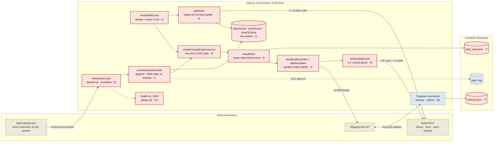
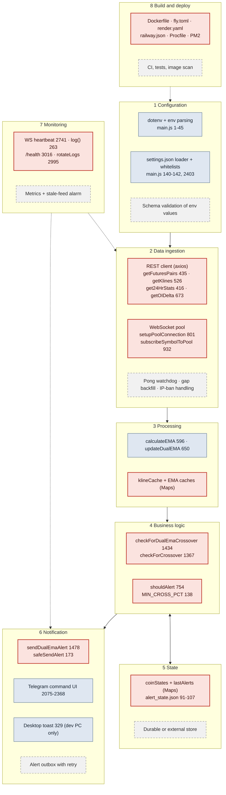
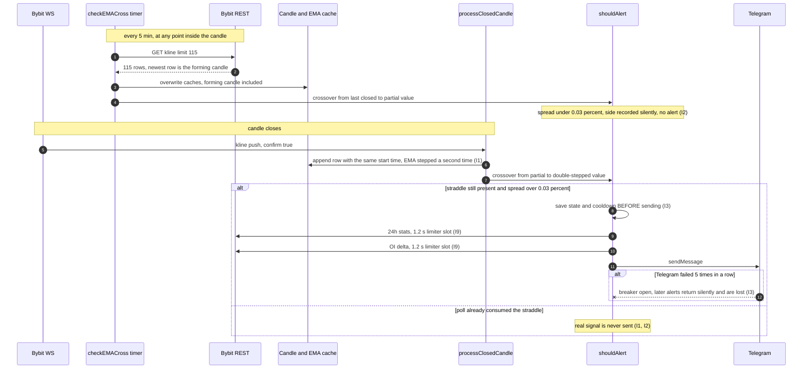
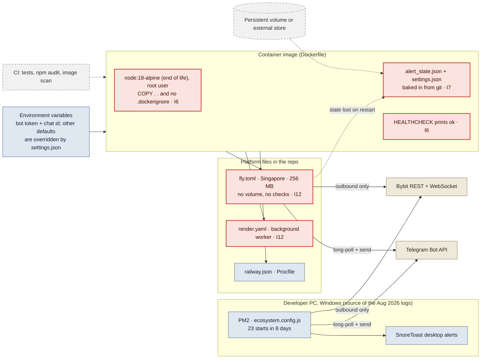
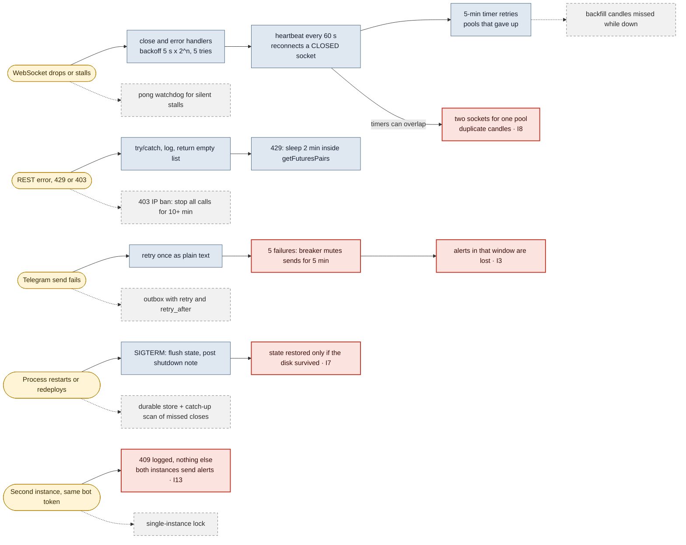
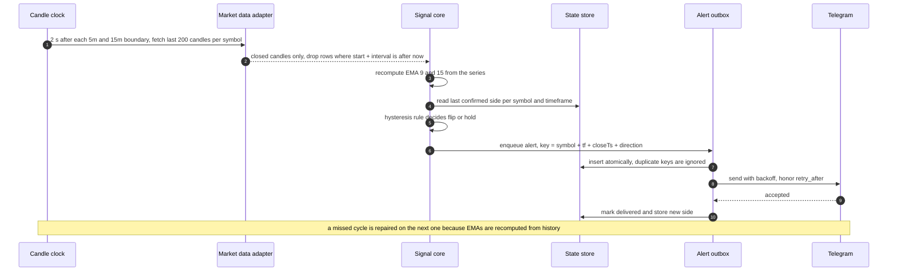

# EMA Tracker architecture review

Audited: `main.js` at commit `12314c9`, 19 Oct 2026. Diagrams are Mermaid and can be edited in place.

Legend: **Exists** (blue), **Exists with a finding** (red), **Missing today** (grey dashed), **Proposed** (green dashed), **External** (tan).

## Improvement areas, ranked

### Fix Now

**I1. Two writers share one candle cache** (effort: S, hours)

The REST backup poll (`checkEMACross`, main.js:1707, run at startup on line 3076 and every 5 minutes on line 3125) writes the unfinished candle into the same cache the WebSocket path appends to. `getKlines` (526) keeps Bybit's newest row, which a live API probe confirmed is the open candle. `processClosedCandle` (967) then appends the confirmed candle without checking its start time. In a replay of real candles the WebSocket-only control matched 160 of 160 expected alerts. The as-built pipeline sent 22 to 42 of them, plus 56 to 67 alerts that the bot's own rule does not produce on closed candles.

*Fix:* Drop rows where start + interval is later than now, skip candles whose start is not newer than the last stored one, and make the poll seed-only (no alerts, no state changes).

**I2. The 0.03% margin discards 79% of crossovers** (effort: S, needs your decision)

The margin (`MIN_CROSS_PCT`, line 138, used on lines 1442 and 1455) is tested once, on the crossing candle. If the spread is smaller, the new side is recorded and that crossover can never alert, even when the spread clears the margin on the next candle. Across 8 pairs, 589 of 749 raw crossovers were dropped, and 201 of those were above the margin one candle later. How strict the filter should be is your call. The rule should wait for confirmation instead of discarding.

*Fix:* Hysteresis: persist the last alerted side and alert when the spread passes the margin on the opposite side.

**I3. Alerts can be lost without a trace** (effort: M, 1 to 3 days)

`shouldAlert` saves state and cooldown before the message is sent (764-768). `safeSendAlert` returns silently while its breaker is open (173-176) and its callers still log success (737, 1523). Reproduced: after five failures, calls six and seven return with no Telegram request. The August logs show two "Failed to send even simplified message" errors. There is no retry and no record of what was dropped.

*Fix:* An outbox with an idempotency key (symbol + timeframe + candle close + direction), retry with backoff and Telegram's `retry_after`, and state updated only when Telegram accepts the message.

**I4. Secrets in the public repository history** (effort: S, hours)

github.com/Rupangshudutta/Ema_Tracker is public. Commits d5a7dc1 and 8947c13 contain a Telegram-token-shaped string and a numeric chat ID in `ecosystem.config.js`, `node.js` and `nodejsDump.txt`. They are gone from HEAD and still in history. The token in your local `.env` is a different string, so it was probably rotated. I did not test the old one. If it was never revoked, anyone holding it can send messages as that bot.

*Fix:* Confirm the old token is revoked in @BotFather, add secret scanning (for example gitleaks) to commits, and purge history only if you want it clean once the token is dead.

**I5. A failed stats call breaks the alert formatter** (effort: XS, minutes)

`get24HrStats` returns `quoteVolume` as the string '0' on error (429-431). `formatVolume` (396) then throws `volume.toFixed is not a function`. Reproduced, and the same error is in the August logs twice. The alert degrades to a one-line message and the desktop toast is skipped.

*Fix:* Return numbers, and send the alert before fetching extras.

**I6. The container image is not production-safe** (effort: S, hours)

The Dockerfile uses node:18-alpine (nodejs.org lists Node 18 and 20 as end of life), runs as root, and has a HEALTHCHECK that only prints ok (line 26). There is no `.dockerignore`, so `COPY . .` (line 18) copies a local `.env`, logs and host `node_modules` into the image when built from a dev folder. I did not run a build.

*Fix:* Current LTS base image, `USER node`, a `.dockerignore` (.env, node_modules, logs, state files), and a healthcheck that calls /health and fails when the feed is stale.

### Improve Next

**I7. State lives on disk that may not survive** (effort: S to M)

`alert_state.json` and `settings.json` are written beside the code (91, 2391), tracked in git, and baked into the image (Dockerfile:18). fly.toml has no volume. Fly's docs describe Machine storage as ephemeral and Render states that free web services have an ephemeral filesystem. Writes happen in place (102-107), so a crash mid-write can leave a truncated file, and the loader then starts empty.

*Fix:* Write to a temp file and rename, keep runtime state out of git, and use a volume or a small external store on cloud hosts.

**I8. WebSocket liveness has gaps** (effort: M, 1 to 3 days)

The heartbeat checks only `readyState` (2741-2775) and there is no pong handler, so a half-open socket goes unnoticed. After five failed reconnects a pool stops (855-865) until a 5-minute timer retries (3090-3104). The 60-second heartbeat and the backoff timer can each create a socket for the same pool index (859-862, 2757-2758), leaving an orphan that still delivers candles (reasoned from the code, not reproduced). Reconnects do not reload history, so missed candles become a gap the EMA treats as contiguous. A duplicate delivery added one duplicate row and about 0.2 bps of EMA drift in my test.

*Fix:* Track pong time and reconnect on silence, close the old socket before replacing it, reseed from REST after every reconnect, and ignore candles that are not newer than the last stored one. Or drop the WebSocket (see Proposed).

**I9. Alert latency and request pattern** (effort: S, hours)

Every alert waits for two 1.2-second limiter slots (703-704, 1487-1488), so bursts queue: 16 simultaneous crossovers (8 pairs x 2 timeframes) means at least 38 s for the last one, and 68 means at least 163 s. Bybit allows 600 requests per 5 s per IP, about 140 times the limiter's rate. `fetchInChunks` (1694) receives promises that are already running, so its batching does nothing: in a test, 40 tasks all started within 1 ms and the function added 471 ms of waiting. Each poll also downloads the full tickers list, 172 KB gzipped (678 KB raw).

*Fix:* Send the alert first and enrich afterwards, cache the tickers response for 30 s, and replace the 1.2 s queue with a token bucket sized to Bybit's real limit.

**I10. Dependencies and runtime** (effort: S to M)

`npm audit` reports 19 findings: 2 critical, 7 high, 10 moderate. Affected direct packages are axios, ws, figlet, chokidar, node-notifier and node-telegram-bot-api (its critical findings come through the deprecated `request` chain). In-range updates exist for axios (1.20.0), ws (8.22.0) and figlet (1.12.0). node-telegram-bot-api 2.1.0 is a major jump to test first. `fs` and `path` in package.json are placeholder npm packages, and brain.js and TensorFlow are imported but not declared.

*Fix:* Update inside ranges, remove `fs`, `path` and `chokidar` from dependencies, and move the ML packages to optional.

**I11. Single-EMA mode starts from too little history** (effort: XS, minutes)

`getKlines` requests period + 100 candles (526-531). For EMA 200 that leaves 37% of the seed error. Against a long-history EMA the median gap was 10.9 bps, the 95th percentile 91.8 bps, and the above/below side differed on 4.8% of samples (EMA 100: 3.4 bps, 29.5 bps, 1.8%). EMA 9/15 mode is not affected.

*Fix:* Request at least 3 x period candles (Bybit allows 1,000).

**I12. Hosting claims in the repo do not hold for $0** (effort: S, hours)

fly.toml says 3 free VMs, but Fly's docs say new organizations have no free tier. render.yaml uses a Background Worker, and Render lists only web services, Postgres and Key Value as free. The README says Railway gives $5 a month, while Railway's docs describe a one-time $5 trial and then $1 a month. The committed settings.json (EMA 100, dual mode on) also overrides the EMA_PERIOD=200 in fly.toml and render.yaml. See the hosting table.

*Fix:* Pick a runner from the hosting table, delete the platform files you will not use, and make the README match.

**I13. Observability and log hygiene** (effort: S, hours)

About 11,600 identical "Telegram polling error ... ENOTFOUND" lines in 8 days of logs, each written synchronously by `log()` (263). `/health` always answers ok (3016) and nothing compares `lastCandleTime` with the clock. Logs rotate only at startup (2995). 45 "Conflict: terminated by other getUpdates" lines show two instances ran on one token, which also means duplicate alerts.

*Fix:* Collapse repeated errors, report the age of the last good cycle on /health and as a Telegram alert, and take a single-instance lock.

### Future Enhancement

**I14. Split the monolith and add tests** (effort: M to L)

main.js holds config, networking, indicators, alerts, the Telegram UI, ML and desktop toasts in 3,152 lines with no tests. `scripts/data_sync.js` hardcodes a personal Windows path, and SECURITY.md contains pasted notes that still mention Binance.

*Fix:* Extract the signal core and the exchange adapter first, and use the replay data from this review as the first regression suite.

## Architectures

### Current architecture, as built

Two paths write the same candle cache: the REST backup poll (left) and the WebSocket pool. Red nodes carry a finding; the tag (I1, I2…) points to the improvement list.

### Layered architecture, mapped to the repository

Line numbers are in main.js. Grey dashed boxes are layers or capabilities the project does not have yet.

### Sequence: candle to Telegram, as built

The REST poll lands inside the candle, consumes the crossover with a sub-margin spread, and the later WebSocket step has nothing left to detect. Reproduced on real candles (see Evidence).

### Deployment view, as configured

The logs show the bot actually ran on a Windows PC under PM2. The container and platform files exist in the repo; whether any platform is live was not verified.

### Failure handling: what exists and what is missing

Blue boxes are handled today, red boxes are handled in a way that loses data, grey dashed boxes are missing.

### Proposed architecture

Same Telegram UI, same EMA function, one candle writer. The runner is a thin shell, so the same core runs as an always-on process or as a scheduled job. Green dashed boxes are proposed, blue boxes are reused from today.

```mermaid
flowchart LR
  subgraph RUN["Runner, pick one"]
    direction TB
    R1["Always-on Node process<br/>timer aligned to candle close"]:::proposed
    R2["Scheduled job<br/>GitHub Actions or Cloudflare Cron"]:::proposed
  end
  CFG["Config schema + validation<br/>fails fast on bad env"]:::proposed
  MD["Market data adapter<br/>REST klines, closed candles only"]:::proposed
  CORE["Signal core, pure functions<br/>calculateEMA reused<br/>hysteresis side machine"]:::proposed
  ST[("State store<br/>atomic JSON file, or KV, or git branch")]:::proposed
  OB["Alert outbox<br/>idempotent key, retry, retry_after"]:::proposed
  SND["Telegram sender"]:::existing
  CMD["Telegram command UI<br/>existing code, optional in job mode"]:::existing
  WD["Watchdog<br/>age of last good cycle<br/>on /health and as an alert"]:::proposed
  BY["Bybit REST"]:::ext
  TGA["Telegram Bot API"]:::ext
  WS["WebSocket feed<br/>optional later, only for sub-minute latency"]:::missing
  CFG --> RUN
  RUN --> MD
  MD -->|"GET kline"| BY
  MD --> CORE
  CORE <--> ST
  CORE --> OB
  OB <--> ST
  OB --> SND
  SND --> TGA
  TGA <--> CMD
  CMD --> CFG
  RUN --> WD
  WD -.->|"stale feed alert"| OB
  WS -.-> MD

  classDef existing fill:#dfe7f1,stroke:#4a6684,color:#14202e;
  classDef defect fill:#fbe3df,stroke:#c0392b,stroke-width:2px,color:#3b0d08;
  classDef missing fill:#f1f1f1,stroke:#7d7d7d,stroke-dasharray:5 4,color:#2c2c2c;
  classDef proposed fill:#dff3e6,stroke:#1e7f4f,stroke-width:2px,stroke-dasharray:6 3,color:#0d2e1c;
  classDef ext fill:#efe9dc,stroke:#8a7a52,color:#2b2412;
  classDef trigger fill:#fff4d6,stroke:#b58105,color:#3a2a00;
```

### Sequence: candle to Telegram, proposed

One writer, closed candles only, stateless EMA recompute, and an idempotent outbox. Nothing is marked as sent until Telegram accepts it.

## Current versus proposed

| Area | Current | Proposed | Benefit | Trade-off | Effort | Priority |
| --- | --- | --- | --- | --- | --- | --- |
| Candle intake | REST poll and WebSocket both write the cache, forming candle included | One writer, closed candles only, dedupe by start time | Alerts match the closed-candle rule (160 of 160 in replay) | Small patch now, cleaner rewrite later | S | Fix Now |
| Crossover rule | One-shot margin gate on the crossing candle | Hysteresis on a persisted side | Valid crossovers are delayed one candle instead of discarded | You choose how strict the margin is | S | Fix Now |
| Alert delivery | State saved before send, breaker drops silently | Outbox with idempotent key and retry | No silent loss and no duplicates | One more component, needs durable state | M | Fix Now |
| Runtime and image | Node 18, root, no .dockerignore, no-op healthcheck | LTS Node, non-root, .dockerignore, real healthcheck | Closes known security and hygiene gaps | None of note | S | Fix Now |
| Data source | WebSocket pool, heartbeat and REST backup | REST klines after each candle close, EMAs recomputed from the series; WebSocket optional later | Removes the reconnect, gap and duplicate-socket classes and runs as a scheduled job too | Alerts arrive seconds after the close, not sub-second. 16 to 68 requests per 5 minutes against a 600 per 5 s limit | M | Improve Next |
| State | JSON beside the code, tracked in git, in-place writes | Atomic write, outside git, volume or KV on cloud | Survives restarts and redeploys | An extra service on some hosts | S to M | Improve Next |
| Liveness | readyState check, /health always ok | Age of the last good cycle on /health and as an alert | Silent stalls become visible | Small | S | Improve Next |
| Latency | Two serialized 1.2 s calls before every alert | Send first, enrich after, cache tickers, token bucket | Removes the 2.4 s floor per alert | Alert text may arrive without 24h stats | S | Improve Next |
| Configuration | Env parsed with \|\| defaults, settings.json overrides silently | Schema validated at startup, one documented precedence | Fewer surprises across hosts | Small | S | Improve Next |
| Code structure | One 3,152-line file with ML and toasts | Modules: config, exchange, signal, notify, state | Testable core | Needs a few days of refactoring | M to L | Future Enhancement |

## Hosting under $0 and no card

| Option | $0 | No card | Continuous worker | Durable state | What the docs say |
| --- | --- | --- | --- | --- | --- |
| Fly.io | No | Trial only | Yes | Volumes, $0.15 per GB-month | "New organizations don't have a free tier." The trial lasts up to 2 hours of Machine runtime or 7 days and needs no card to start; a card is required after. shared-cpu-1x 256 MB costs $2.19 a month (iad). |
| Render | Web services only | Not stated | Not for workers. Free web services spin down after 15 minutes without inbound traffic | No, filesystem is ephemeral | Background Workers are not a free instance type. 750 free hours per month per workspace. |
| Railway | Trial, then $1 a month credit | Not stated | Only while credit lasts | Trial volumes deleted 30 days after credits expire | One-time $5 for 30 days; limited trial accounts have restricted outbound network access. RAM is $10 per GB-month, so a process holding 100 MB (assumed, not measured) uses the whole $1 credit on RAM alone. |
| GitHub Actions, scheduled | Yes, public repo | A GitHub account (no card mentioned in the pages read) | No | Via repo, cache or artifact | Shortest interval 5 minutes; "can be delayed during periods of high loads" and queued jobs may be dropped. Disabled after 60 days without repository activity in a public repo. 6 hours per job. |
| Cloudflare Workers Cron + KV | Yes, Free plan | Not stated on the limits page | No, cron-driven | KV: 1,000 writes and 100,000 reads per day | Free plan: 10 ms CPU per cron invocation, 50 subrequests per invocation, 5 cron triggers. The larger pair universe (68 kline calls) must be split across invocations. |
| Oracle Cloud Always Free | Reported yes | No, per your README | Yes | Yes | Oracle's page returned HTTP 403, so this is unverified. Your README says a card is needed for verification. |
| A machine you control | Yes | Yes | While powered and online | Local disk | Your August logs show Telegram DNS failures lasting up to 2 h 38 min (13 Aug) and 23 starts in 8 days. |

## Evidence

Replay of real Bybit candles (8 pairs, 999 closed candles each, fetched 18 Oct 2026) through the bot's own functions with mocked I/O.

| Run | Setup | Expected | Correct | Missed | Extra |
| --- | --- | --- | --- | --- | --- |
| A | WebSocket only (control, closed candles) | 160 | 160 | 0 | 0 |
| B | As built, poll at 50% of a 5m candle and 20/53/87% of a 15m candle | 160 | 22 | 138 | 64 |
| C | As built, poll near candle open (5%) | 160 | 42 | 118 | 67 |
| D | As built, poll near candle close (95%) | 160 | 38 | 122 | 56 |
| F | WebSocket only with the 15-minute cooldown from fly.toml | 160 | 159 | 1 | 0 |

| Test | Result |
| --- | --- |
| Margin gate | 749 raw EMA 9/15 crossovers on closed candles, 160 pass the 0.03% margin, 589 dropped (78.6%), 201 of the dropped were above the margin one candle later |
| formatVolume after a failed stats call | TypeError: volume.toFixed is not a function (also in the August logs) |
| Circuit breaker | Calls 1 to 5 throw, calls 6 and 7 return undefined, no Telegram request is made |
| fetchInChunks with 40 running promises | All 40 started within 1 ms; 471 ms of artificial waiting |
| Same candle delivered twice | 1 duplicate row, EMA 9 +0.18 bps, EMA 15 +0.21 bps (BTCUSDT 5m) |
| Cooldown | 0 cooldown skips at the 60 s default, 1 skip at 900 s across 160 expected alerts |

| Mode | Candles fetched | Seed error left | Median gap bps | 95th pct bps | Max bps | Side differs |
| --- | --- | --- | --- | --- | --- | --- |
| EMA 50 | 150 | 1.8% | 0.29 | 2.52 | 8.83 | 0.13% |
| EMA 100 | 200 | 13.5% | 3.4 | 29.45 | 70.91 | 1.81% |
| EMA 200 | 300 | 36.8% | 10.92 | 91.76 | 216.09 | 4.84% |

## Not verified

- Whether any cloud deployment is live. Only the platform files exist in the repo.
- Whether the old token is still valid. I deliberately did not test it.
- Single-EMA mode under replay. It has the same structure, but only EMA 9/15 mode was replayed.
- Real intrabar prices. The replay assumes the partial close sits on a straight line from open to close.
- The double-socket race in I8. It is reasoned from the code, not reproduced.
- A Docker build, and CPU or memory use. No benchmark was run.
- Oracle's terms (page blocked) and real-world cron delays on GitHub Actions or Cloudflare.

## Sources

- [Bybit WebSocket connect](https://bybit-exchange.github.io/docs/v5/ws/connect)
- [Bybit rate limits](https://bybit-exchange.github.io/docs/v5/rate-limit)
- [Fly.io pricing](https://docs.fly.io/about/pricing)
- [Render free instances](https://render.com/docs/free)
- [Railway free trial](https://docs.railway.com/reference/pricing/free-trial)
- [Railway plans and usage pricing](https://docs.railway.com/reference/pricing/plans)
- [GitHub Actions schedule event](https://docs.github.com/en/actions/reference/workflows-and-actions/events-that-trigger-workflows)
- [GitHub Actions limits](https://docs.github.com/en/actions/reference/limits)
- [GitHub Actions billing](https://docs.github.com/en/billing/concepts/product-billing/github-actions)
- [Cloudflare Workers limits](https://developers.cloudflare.com/workers/platform/limits/)
- [Cloudflare KV limits](https://developers.cloudflare.com/kv/platform/limits/)
- [Telegram Bot FAQ](https://core.telegram.org/bots/faq)
- [Node.js releases](https://nodejs.org/en/about/previous-releases)
