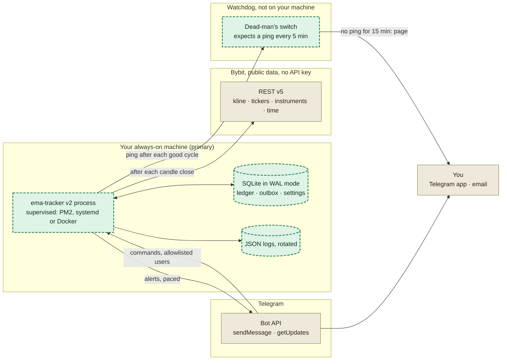
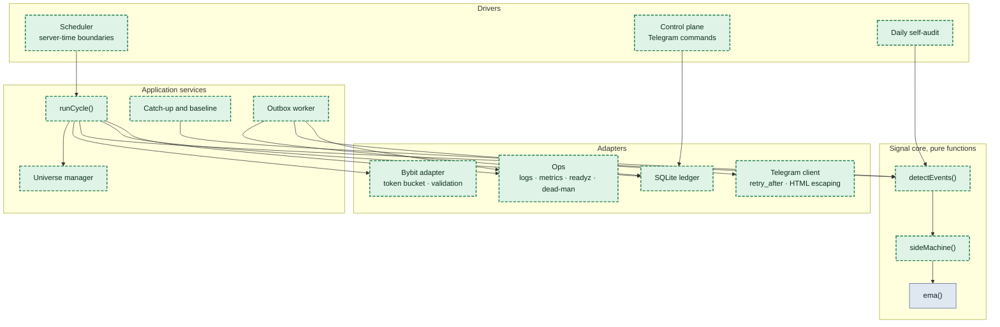
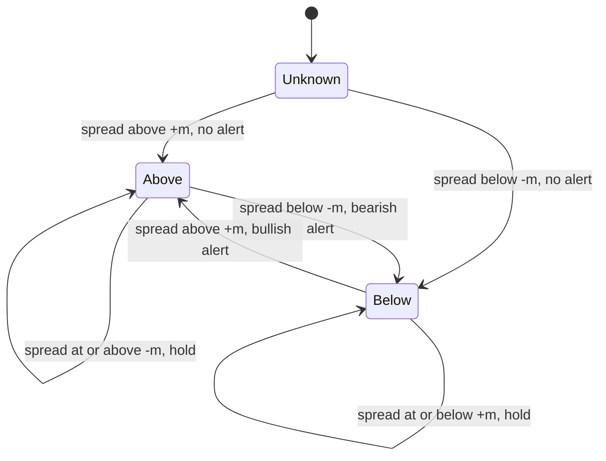
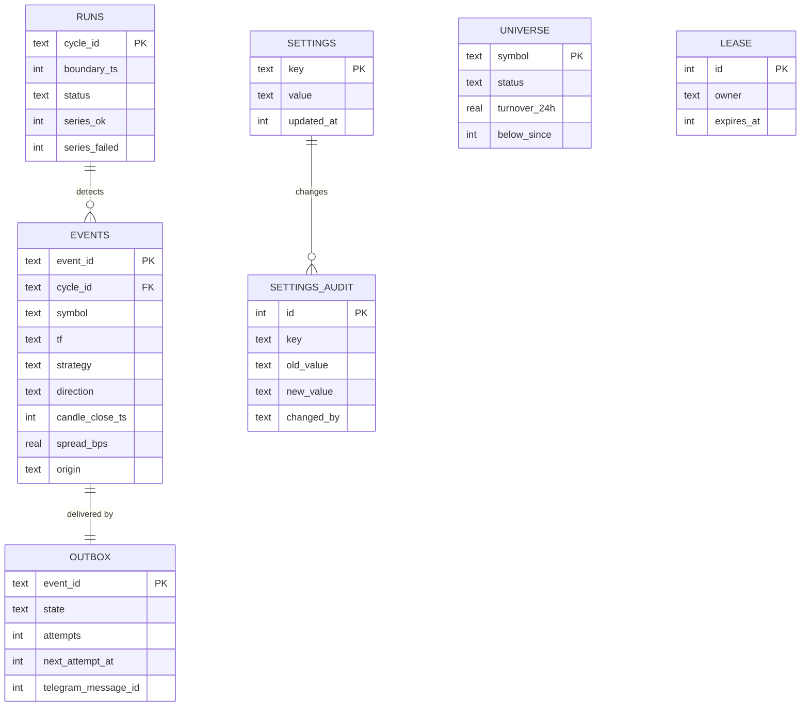
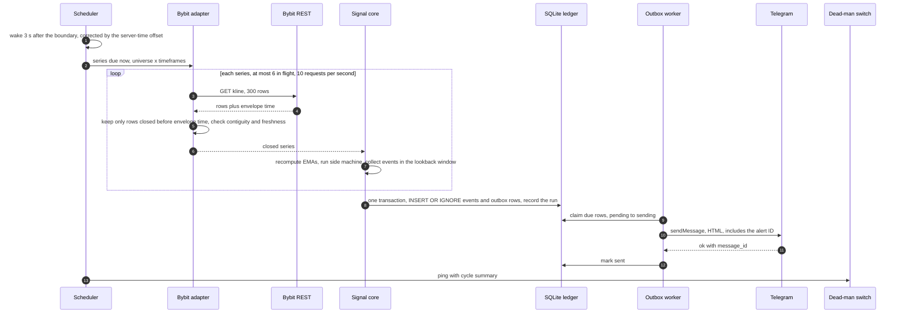
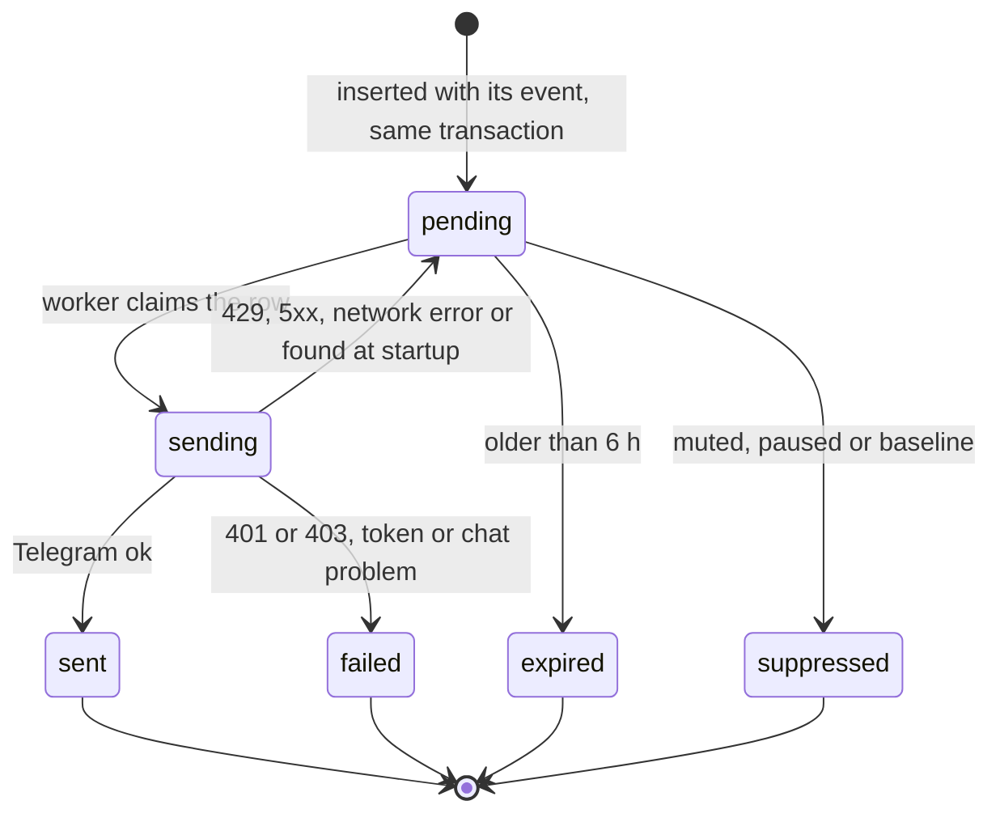
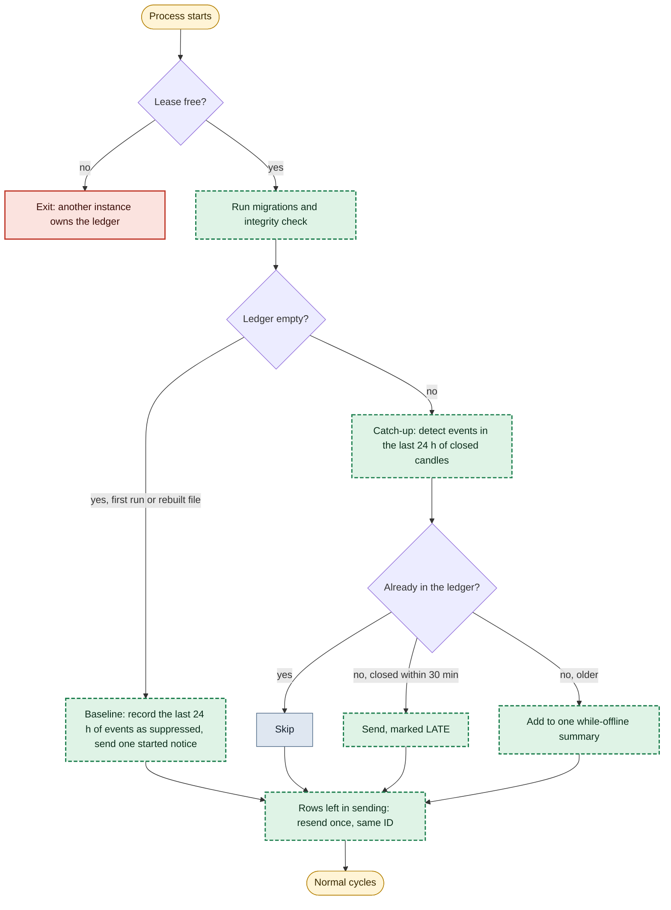
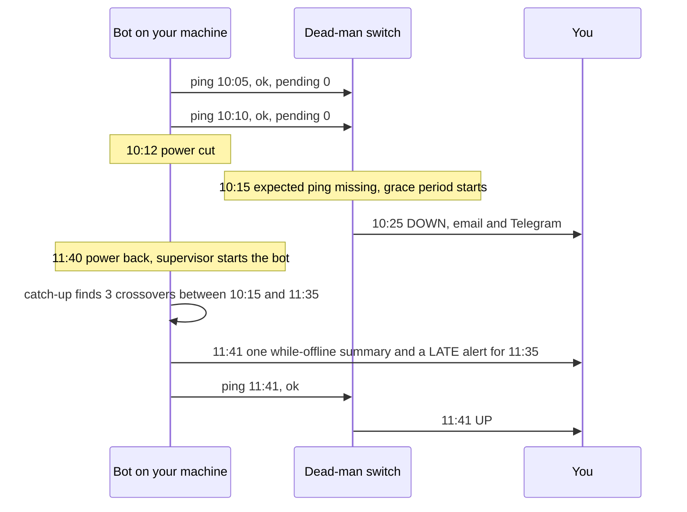
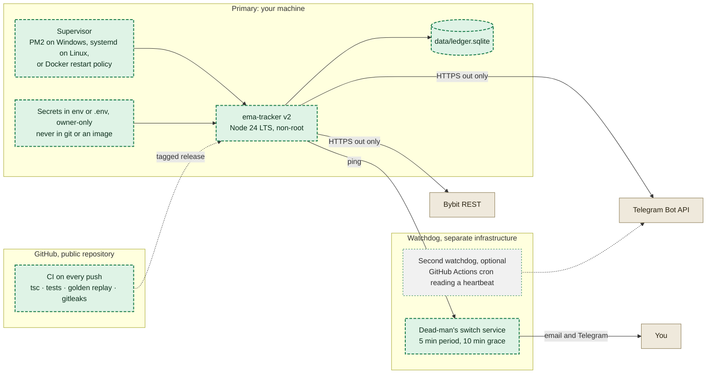

# EMA Tracker v2 system design

Based on `main.js` at commit `12314c9`, 19 Oct 2026. Companion to `docs/ARCHITECTURE_REVIEW.md`. Diagrams are Mermaid and can be edited in place.

> Every 5 minutes, 3 seconds after a candle closes by Bybit's clock, the bot downloads closed candles for each tracked pair, recomputes the EMAs from scratch, and runs a rule that only flips sides when the spread clears the margin. New events and their delivery rows are written to SQLite in one transaction. A worker sends them to Telegram and keeps retrying until Telegram accepts them. After each good cycle the bot pings a dead-man's switch on other infrastructure, which pages you if the pings stop.

Legend for diagrams: green dashed = new in v2, blue = reused from today, grey dashed = optional, tan = external, yellow = trigger, red = stop or refusal.

## 1. What "cannot break" means here

No design can promise that Bybit, Telegram, your internet connection or your PC never fail. This one promises what happens when each of them does. Every guarantee below is enforced by a specific mechanism and checked by a test or a monitor (sections 10 and 14).

| ID | Guarantee | How it is enforced | Checked by |
| --- | --- | --- | --- |
| G1 | Only candles the exchange has closed are used. | Closed means `start + interval ≤ envelope time` from Bybit and the next candle already exists. Rows must be contiguous. Otherwise the series is skipped for that cycle and counted. | Contract tests on recorded responses; `data_rejected_total` metric |
| G2 | Signals are a pure function of candle history. | EMAs and the side are recomputed from the fetched series every cycle. There is no incremental state that can drift. | Golden replay of the 16 audit series; property tests |
| G3 | No signal is lost silently. | Event and outbox row are written in one SQLite transaction. A row is marked sent only after Telegram returns ok. Failures are retried, then reported. | Fault-injection tests; daily self-audit of yesterday's events against the ledger |
| G4 | The system heals itself after downtime. | Every cycle scans the last 24 h. Missing events up to 30 min old are sent marked LATE; older ones go into one summary. | Restart test with a 3 h gap |
| G5 | Duplicates are prevented, and recognisable if one slips through. | Event ID = hash of symbol, timeframe, mode, candle close and direction; unique in the ledger and printed in every message. | Unit test; crash test between send and commit |
| G6 | Outages are reported from outside your machine within 15 minutes. | A dead-man's switch on separate infrastructure expects a ping after every good cycle and emails or messages you when it stops. | Monthly drill: stop the process and time the page |
| G7 | Only one process sends with the bot token. | A lease row in SQLite on the same host; Telegram's 409 Conflict from another host stops sending and raises an alert. | Two-instance test |

### What it cannot promise at $0 on one machine

- Alerts while your machine, power or internet is down. You are told about the outage (G6) and the missed signals arrive when it is back (G4).
- Delivery while Telegram itself is down. Alerts queue and go out afterwards; the watchdog reaches you by email.
- Exactly-once delivery. Telegram's `sendMessage` has no idempotency key, so a crash after Telegram accepts a message and before the ledger records it can produce one duplicate, with the same alert ID.
- Safety on a compromised host. The bot holds no exchange keys, which limits the damage to the Telegram token.

## 2. Requirements

### Functional

| ID | Requirement |
| --- | --- |
| FR1 | Track Bybit USDT linear perpetuals with 24 h turnover above a threshold (100M default; 20M, 50M, 200M selectable) and status Trading. |
| FR2 | Strategy A: EMA 9 against EMA 15 on 5m and 15m together. Strategy B: close against EMA 50, 100 or 200 on one timeframe from 1m to 4h. |
| FR3 | Alert when the side flips past the margin, per symbol, timeframe and strategy. The margin is a setting; section 6 has the data for choosing it. |
| FR4 | Telegram alert with price, both EMAs, spread, 24 h change and volume, OI delta when available, candle close time in UTC, TradingView link and alert ID. |
| FR5 | Telegram control for allowlisted users: status, settings, pause and resume, mute a symbol, test alert, run the audit. |
| FR6 | Notify when a pair enters or leaves the tracked set. |
| FR7 | After downtime, deliver missed signals (LATE alerts, or one summary for older ones). |

### Non-functional targets (SLOs)

| Area | Target | How it is measured |
| --- | --- | --- |
| Correctness | 100% agreement with the reference rule on closed candles | CI golden replay; daily self-audit with 0 discrepancies |
| Timeliness | p95 ≤ 20 s, p99 ≤ 60 s from candle close to Telegram accepting the alert, while the host is up | `alert_latency_seconds` histogram |
| Detection | Any outage reported within 15 min | Watchdog drill |
| Durability | 0 recorded events lost across process crashes | SQLite WAL with `synchronous=FULL`; kill -9 tests |
| Recovery | Crashed process back within 60 s; missed signals sent on the first good cycle | Supervisor restart test; restart-gap test |
| Cost | $0, no card, zero third-party runtime packages | package.json review in CI |
| Security | No secrets in git or images; control limited to allowlisted user IDs | gitleaks in CI; command tests |

### Constraints (verified)

- Bybit says IP addresses in the US or mainland China get HTTP 403. Market data must therefore come from a host Bybit accepts. Your PC passed a live probe on 18 Oct 2026. US-hosted free runners such as GitHub Actions cannot be the data source.
- Bybit allows 600 REST requests per 5 s per IP and returns at most 1,000 kline rows per request (both checked).
- Telegram: about 1 message per second per chat and 20 per minute in a group; a 429 carries `retry_after`; message text is limited to 4,096 characters.
- Your PC's clock was 9.5 s behind Bybit's server clock when measured. Local time cannot decide whether a candle is closed.
- Node 24.21 on your PC runs TypeScript files directly and ships `node:sqlite`; both were tested without flags or extra packages.
- One developer, $0, no card. No free platform I could verify offers an always-on worker with durable storage under those terms (see the architecture review's hosting table).

## 3. Key decisions

| ID | Decision | Why (evidence) | Rejected alternative |
| --- | --- | --- | --- |
| D1 | Fetch closed candles over REST right after each candle closes. No WebSocket in the alert path. | The current WebSocket plus REST mix delivered 22 to 42 of 160 expected alerts in replay. REST-on-close is stateless, and seconds of delay do not matter on 5m and 15m candles. Load peaks at 69 requests at a quarter-hour boundary with 34 pairs, against a limit of 600 per 5 s. | WebSocket only: needs gap backfill, liveness tracking and dedupe, for sub-second latency the strategy does not use. |
| D2 | Use Bybit's envelope time for every closed-candle decision. | Measured 9.5 s local clock offset. | `Date.now()`. |
| D3 | Recompute EMAs from history every cycle: 300 candles for EMA 9/15, 1,000 for EMA ≥ 100. | Seed error left after 285 steps of EMA 15 is below 1e-16. For EMA 200 the current 300-candle window left a 10.9 bps median error; 1,000 candles leave 0.03% of the seed error. | Incremental EMA updates, which drifted and double-stepped (I1). |
| D4 | Hysteresis side machine for alerts. | 589 of 749 raw crossovers were discarded by the one-shot gate; 201 of them cleared the margin a candle later. Prototyped on the audit data: identical decisions on 300 and 1,000-candle windows (9,584 of 9,584), and margin 0 reproduces all 749 raw crossovers. | Margin checked only on the crossing candle. |
| D5 | One SQLite file through `node:sqlite`, WAL mode, transactional outbox. | Atomic and crash-safe, no native build, ran on your Node. `INSERT OR IGNORE` gives idempotency (tested). | JSON files (not atomic, I7); hosted databases (card or cost). |
| D6 | At-least-once delivery with visible IDs. | Exactly-once is impossible without an idempotency key on Telegram's side. A rare labelled duplicate is better than a miss. | At-most-once, which loses alerts on crashes. |
| D7 | Zero third-party runtime packages. | Native `fetch`, `http`, `node:sqlite` and `node:test` cover everything. Removes the 19 npm audit findings and the supply-chain surface. TypeScript runs through Node's type stripping; `tsc` type-checks in CI only. | axios, ws, node-telegram-bot-api, colors, figlet, node-notifier. |
| D8 | Primary on your hardware, plus a watchdog elsewhere. | Free cloud workers fail the constraints (no free tier, card required, sleeping instances, or US IPs). Detection from outside turns a dead host into a page. | A free cloud worker as primary. |
| D9 | Config as code with validated runtime overrides. | Defaults live in `config/default.json` in git; secrets only in env; every Telegram change writes an audit row. | The current mix, where env, a committed settings.json and code defaults override each other silently. |

## 4. Architecture

### System context

One supervised process on a machine Bybit accepts, one durable file, outbound HTTPS only, and a watchdog on separate infrastructure that pages you when the pings stop.



### Module view (ports and adapters)

The signal core has no I/O and no clock, so it can be replayed and property-tested. Everything that talks to the outside world is an adapter behind an interface. ema() is the existing calculateEMA, which matched 160 of 160 events in the audit control run.



## 5. Components

| Component | Responsibility | Rules that keep it correct |
| --- | --- | --- |
| Scheduler | Wakes 3 s after each 5-minute boundary (server-time corrected) and decides which timeframes are due. | One cycle at a time. A late cycle never stacks; a skipped boundary is counted and repaired by the next recompute. Cycle budget 60 s. |
| Universe manager | Keeps the tracked set from one tickers call every 15 min (172 KB gzipped). | Add above T; remove below 0.8 T for 60 min, or at once if the instrument stops Trading. New symbols start with a baseline, so no historical alerts. |
| Bybit adapter | Fetches klines, tickers, instrument status and server time. | Token bucket 10 req/s, 6 in flight, 8 s timeout, 3 retries with jitter inside the cycle budget. Validates `retCode`, finite numbers, ascending and contiguous rows, closed filter by envelope time, and that the newest closed candle is the expected one. A 403 opens a 15-minute global circuit and alerts you (Bybit asks for at least 10 minutes). |
| Signal core | `ema()`, `sideMachine()`, `detectEvents()`. | Pure: no I/O, no clock, no globals. Same input, same output. |
| Ledger | SQLite: events, outbox, runs, settings, universe, lease, Telegram offset. | One transaction per cycle; WAL with `synchronous=FULL`; `PRAGMA integrity_check` daily; retention 180 days for events, 30 days for runs. |
| Outbox worker | Delivers due rows to Telegram. | Paces 1 message per second per chat; sends a digest when 4 or more events land in one cycle; HTML parse mode with escaping; splits at 4,096 characters. 429 waits exactly `retry_after`; 5xx and network errors back off from 2 s to 5 min; 400 retries as plain text; 401 or 403 stops sending and fails the heartbeat; rows expire after 6 h and are reported. |
| Enricher | Adds 24 h change, volume and OI delta to the message. | Reads the cached tickers instead of a new request; OI has a 2 s timeout. Enrichment can never delay or block an alert. |
| Control plane | Telegram commands and settings menus (reusing today's menu layout). | `getUpdates` long poll with the offset stored in SQLite; accepts only allowlisted `from.id` values and ignores everyone else without replying; every change validated and audited. |
| Ops | Logging, metrics, health, heartbeat, self-audit. | JSON logs with daily rotation, 14-day retention and repeat suppression. `/healthz`, `/readyz` and `/metrics` bound to 127.0.0.1. Heartbeat after each good cycle, fail ping on a failed one. Self-audit at 00:10 UTC. |
| Lifecycle | Start-up, shutdown, single instance. | Lease row renewed every cycle. On SIGTERM: stop claiming, finish the current send, close the database. On start: migrations, integrity check, catch-up or baseline. |

## 6. Signal rule

For each closed candle t of a series, the engine computes a spread and updates a side. Strategy A uses `fast = EMA 9` and `slow = EMA 15`. Strategy B uses `fast = close` and `slow = EMA N`.

```text
spread_t = (fast_t - slow_t) / slow_t
side_t   = ABOVE         if spread_t >  +m
         = BELOW         if spread_t <  -m
         = side_(t-1)    otherwise
event at t  when side_t != side_(t-1) and side_(t-1) != UNKNOWN
event_id    = first 16 hex of sha256(symbol | tf | strategy | close_ts | direction)
```

The side starts as UNKNOWN at the start of the fetched window, and the first move outside the band sets it without an alert. After that first exit the result no longer depends on how far back the window starts, which is what lets every cycle recompute from scratch.

### Signal side machine

m is the margin (today 3 bps as MIN_CROSS_PCT; see the sweep below for choosing it). The side only changes when the spread clears the margin on the other side, so a crossover that is too small on its first candle is confirmed later instead of discarded. With m = 0 it reproduces plain crossovers.



### Prototype results on the audit data

I implemented this rule as specified, using the existing EMA function, and ran it on the 16 recorded series (8 pairs x 5m and 15m, 999 closed candles each).

- Window invariance: 9,584 of 9,584 per-candle decisions were identical with a 300-candle window and with up to 1,000 candles. Recomputing from scratch is safe.
- With margin 0 the rule finds all 749 raw crossovers, the same count as the audit.
- 151 of the 160 alerts today's rule raises are also raised by the new rule, on the same candle or one earlier.

### Choosing the margin

The margin now means what it says, so the same number produces many more alerts than today's one-shot gate. This is a product decision. The table gives the data. "Reversed within 3 candles" is a whipsaw count, not a measure of signal quality, and no profitability was evaluated.

| Margin, bps | Today's rule, events | New rule, events | New rule, per pair per day | Reversed within 3 candles |
| --- | --- | --- | --- | --- |
| 0 | 749 | 749 | 18.2 | 19% |
| 3 (today) | 160 | 480 | 11.0 | 4% |
| 5 | 74 | 392 | 8.9 | 4% |
| 10 | 37 | 246 | 5.6 | 2% |
| 15 | 23 | 178 | 3.9 | 1% |
| 20 | 19 | 142 | 3.1 | 0% |
| 30 | 12 | 96 | 1.9 | 0% |

Recommendation: start the shadow run at 15 bps. It keeps the alert volume close to today's (178 against 160 events) without discarding any valid crossover. Adjust after watching a few days of live alerts; the margin is a config value and the golden replay records the choice.

## 7. Data model

### Data model

Everything durable lives in one SQLite file. Only the ledger (events and outbox) and settings are authoritative. Candles and sides are recomputed, so losing the file loses history, never correctness.



```sql
PRAGMA journal_mode = WAL;
PRAGMA synchronous  = FULL;

CREATE TABLE meta            (key TEXT PRIMARY KEY, value TEXT NOT NULL);
CREATE TABLE lease           (id INTEGER PRIMARY KEY CHECK (id = 1), owner TEXT NOT NULL, expires_at INTEGER NOT NULL);
CREATE TABLE telegram_offset (id INTEGER PRIMARY KEY CHECK (id = 1), update_id INTEGER NOT NULL);

CREATE TABLE settings (key TEXT PRIMARY KEY, value TEXT NOT NULL, updated_at INTEGER NOT NULL, updated_by TEXT NOT NULL);
CREATE TABLE settings_audit (
  id INTEGER PRIMARY KEY, key TEXT NOT NULL, old_value TEXT, new_value TEXT NOT NULL,
  changed_at INTEGER NOT NULL, changed_by TEXT NOT NULL
);

CREATE TABLE universe (
  symbol TEXT PRIMARY KEY, status TEXT NOT NULL, turnover_24h REAL NOT NULL,
  added_at INTEGER NOT NULL, below_since INTEGER, removed_at INTEGER
);

CREATE TABLE runs (
  cycle_id TEXT PRIMARY KEY, boundary_ts INTEGER NOT NULL,
  started_at INTEGER NOT NULL, finished_at INTEGER,
  series_ok INTEGER NOT NULL DEFAULT 0, series_failed INTEGER NOT NULL DEFAULT 0,
  events_new INTEGER NOT NULL DEFAULT 0,
  status TEXT NOT NULL CHECK (status IN ('running','ok','degraded','failed'))
);

CREATE TABLE events (
  event_id TEXT PRIMARY KEY,
  cycle_id TEXT NOT NULL REFERENCES runs(cycle_id),
  symbol TEXT NOT NULL, tf TEXT NOT NULL, strategy TEXT NOT NULL,
  direction TEXT NOT NULL CHECK (direction IN ('up','down')),
  candle_close_ts INTEGER NOT NULL,
  close REAL NOT NULL, fast REAL NOT NULL, slow REAL NOT NULL, spread_bps REAL NOT NULL,
  detected_at INTEGER NOT NULL,
  origin TEXT NOT NULL CHECK (origin IN ('live','late','baseline'))
);
CREATE INDEX events_by_series ON events (symbol, tf, strategy, candle_close_ts);

CREATE TABLE outbox (
  event_id TEXT PRIMARY KEY REFERENCES events(event_id),
  state TEXT NOT NULL CHECK (state IN ('pending','sending','sent','failed','expired','suppressed')),
  attempts INTEGER NOT NULL DEFAULT 0,
  next_attempt_at INTEGER NOT NULL,
  last_error TEXT, telegram_message_id INTEGER, sent_at INTEGER
);
CREATE INDEX outbox_due ON outbox (state, next_attempt_at);
```

## 8. Flows

### One cycle, candle close to Telegram

Every cycle starts from the exchange's closed candles and recomputes everything. Events and outbox rows are written in one transaction before anything is sent, so a crash can delay an alert but cannot lose it.



### Outbox row lifecycle

A row is marked sent only after Telegram returns ok. Rows still in sending after a crash are sent once more with the same alert ID, which is the only way a duplicate can appear.



### Start-up, catch-up and baseline

Because signals are recomputed from history, a restart only has to compare what the engine finds with what the ledger already holds. An empty ledger is treated as a baseline so a fresh install never floods you with old alerts.



### Outage, detection and recovery

Example timeline. The watchdog runs elsewhere, so a dead host still produces a page. Recovery needs no manual step.



## 9. Interfaces and configuration

### Ports (TypeScript, run directly by Node 24)

```ts
export type Tf = '1m' | '5m' | '15m' | '1h' | '4h';
export interface Candle { start: number; open: number; high: number; low: number; close: number; volume: number }
// ascending, contiguous, closed candles only; serverTime comes from Bybit's envelope
export interface ClosedSeries { symbol: string; tf: Tf; serverTime: number; candles: Candle[] }

export interface MarketData {
  closedCandles(symbol: string, tf: Tf, count: number, signal: AbortSignal): Promise<ClosedSeries>;
  tickers(signal: AbortSignal): Promise<Ticker[]>;
  instrumentStatus(signal: AbortSignal): Promise<Map<string, string>>;
}

export interface Strategy { id: string; kind: 'ema_pair' | 'price_ema'; fast?: number; slow: number; marginBps: number; history: number }
export interface SignalEvent {
  eventId: string; symbol: string; tf: Tf; strategy: string; direction: 'up' | 'down';
  closeTs: number; close: number; fast: number; slow: number; spreadBps: number;
}
// pure: no I/O, no clock
export function detectEvents(series: ClosedSeries, s: Strategy, sinceCloseTs: number): SignalEvent[];

export interface Ledger {
  recordCycle(run: RunRecord, events: SignalEvent[], origin: 'live' | 'late' | 'baseline'): void; // one transaction
  claimDue(now: number, limit: number): OutboxItem[];          // pending -> sending
  markSent(id: string, messageId: number, at: number): void;
  markRetry(id: string, nextAt: number, error: string): void;  // sending -> pending
  markTerminal(id: string, state: 'failed' | 'expired', error: string): void;
}

export interface Notifier {
  // throws TelegramError { code, description, retryAfter? }
  send(chatId: string, html: string): Promise<{ messageId: number }>;
}
```

### Operational endpoints (bound to 127.0.0.1)

| Endpoint | Returns |
| --- | --- |
| `GET /healthz` | 200 while the process is alive. |
| `GET /readyz` | 200 when the last good cycle is under 11 min old, the database is writable and the oldest pending alert is under 10 min old; otherwise 503 with the failing reasons. |
| `GET /metrics` | Prometheus text: cycles, durations, fetch errors by reason, rejected series, signals, outbox depth, alert latency, Telegram errors by code, clock skew, universe size. |

### Configuration

Non-secret defaults live in git. Secrets come only from the environment: `TELEGRAM_BOT_TOKEN`, `TELEGRAM_CHAT_ID`, `TELEGRAM_ADMIN_USER_IDS` and `DEADMAN_PING_URL`. The process validates everything at start-up and refuses to run with a clear message if anything is wrong.

```json
{
  "exchange": { "baseUrl": "https://api.bybit.com", "category": "linear", "quote": "USDT" },
  "universe": { "minTurnover24h": 100000000, "removeBelowRatio": 0.8, "removeAfterMinutes": 60, "refreshMinutes": 15 },
  "strategies": [
    { "id": "ema9_15", "kind": "ema_pair", "fast": 9, "slow": 15, "timeframes": ["5m", "15m"], "marginBps": 15, "history": 300 },
    { "id": "price_ema200", "kind": "price_ema", "slow": 200, "timeframes": ["15m"], "marginBps": 3, "history": 1000, "enabled": false }
  ],
  "schedule": { "settleMs": 3000, "cycleBudgetMs": 60000 },
  "delivery": { "digestThreshold": 4, "maxAgeMinutes": 360, "lateWindowMinutes": 30, "catchUpHours": 24 },
  "ops": { "httpBind": "127.0.0.1:9464", "logRetentionDays": 14, "auditUtc": "00:10" }
}
```

## 10. Failure modes

Each row names how the failure is noticed, what the system does without you, and what is left over.

| Failure | Detection | Automatic response | What you see | Residual risk |
| --- | --- | --- | --- | --- |
| Bybit timeout or 5xx on some series | Request error | Up to 3 retries in the cycle budget, then skip; the next cycle recomputes | Nothing unless it repeats | That alert is up to one cycle late |
| Bybit 403 (rate ban or location block) | HTTP 403 | 15-minute global circuit, cycle marked degraded | Telegram notice | No data during the ban; catch-up afterwards |
| Open candle or partial data in the response | Envelope time and next-candle check | Drop open rows; if the expected candle is missing, retry after 2 s, then skip | Nothing | None. This is I1, closed by construction |
| Gap or out-of-order rows | Contiguity check | Refetch once, then skip the series | `data_rejected_total` rises | One cycle late |
| Local clock drift | Skew between local and server time every cycle | Schedule from server time; notify above 5 s | Notice | None for correctness |
| Process crash | Supervisor | Restart within 60 s; WAL keeps the ledger; outbox resumes; catch-up runs | Possibly a LATE alert | One labelled duplicate if the crash fell between send and commit |
| Machine, power or internet down | Dead-man silence | None possible on the host | Page within 15 min, from outside | No alerts until back; then LATE alerts and a summary |
| Telegram 429 | Code 429 with `retry_after` | Wait exactly `retry_after`; use digests | Slightly later alerts | None |
| Telegram unreachable or 5xx | Send errors | Back off up to 6 h; heartbeat reports pending alerts | Watchdog email if alerts stay pending 15 min | Alerts older than 6 h expire and are listed |
| Token revoked or bot blocked (401 or 403) | Telegram error code | Stop sending, mark failed, send the fail ping | Watchdog email | Until you fix the token |
| Two instances on one token | Lease row on the same host; 409 Conflict from another host | Second instance exits or stops sending | Notice | Short overlap |
| Disk full or database corruption | SQLite write error; daily integrity check | `/readyz` 503, fail ping, stop alerting rather than guess | Watchdog email | Downtime until fixed; the file can be rebuilt because signals are derivable |
| Invalid configuration | Schema validation at start-up and on every change | Refuse to start, or reject the change with the reason | Error message | None |
| Symbol delisted or renamed | Instrument status | Remove from the universe | Notice | None |
| Logic regression in a release | CI golden replay; daily self-audit | Block the release, or report the discrepancy | Audit report | Caught within a day if CI missed it |
| Event loop stall | Cycle duration metric; `/readyz` | Supervisor restarts after three failed readiness checks | Possibly a late alert | Small |

## 11. Capacity

Pair counts were measured on 18 Oct 2026: 8 USDT perpetuals above 100M of 24 h turnover, 15 above 50M and 34 above 20M. The 20M setting is the worst case.

| Quantity | N = 8 (default) | N = 34 (worst case) | Basis |
| --- | --- | --- | --- |
| Kline requests per hour, strategy A | 128 | 544 | 12 x N on 5m + 4 x N on 15m |
| Peak requests at a quarter-hour | 17 | 69 | 2 x N + 1 tickers call |
| Seconds to fetch the peak at 10 req/s | 2 | 7 | Token bucket |
| Peak share of Bybit's 600 per 5 s | 3% | 8% | 50 requests per 5 s at most |
| Download per day | ≈ 56 MB | ≈ 180 MB | ≈ 12.5 KB gzipped per 300-row kline (scaled from a measured 4.8 KB per 115 rows) + 172 KB tickers every 15 min |
| Alerts per day, today's rule | ≈ 29 | ≈ 120 | 3.6 per pair per day in the audit replay |
| Alerts per day, new rule at 15 bps | ≈ 31 | ≈ 133 | 3.9 per pair per day (section 6) |
| Alerts per day, new rule at 3 bps | ≈ 88 | ≈ 374 | 11.0 per pair per day (section 6) |
| Ledger growth per year | < 10 MB | < 30 MB | About 200 bytes per event plus 288 run rows a day |

CPU per cycle is tiny (at most 68 EMA passes over 300 values). Memory and cycle duration are tracked by metrics from the first run rather than estimated here.

## 12. Security

| Threat | Control |
| --- | --- |
| Bot token leak (it already happened in git history) | Secrets only in env or an owner-only .env; .gitignore and .dockerignore cover them; gitleaks in CI and as a pre-commit hook; turn on GitHub secret scanning and push protection in repository settings; documented rotation in @BotFather. |
| Someone else controls the bot | Allowlist of Telegram user IDs (`from.id`), not chat IDs; others are ignored without a reply; rate limit on commands; every change audited. |
| Malicious or broken package | Zero third-party runtime packages; dev tools pinned in the lockfile; npm audit in CI; Node LTS kept patched. |
| Malformed or hostile exchange data | Every response validated (types, finite numbers, ordering, contiguity, size), timeouts on every call, failures counted and never guessed around. |
| Exposed admin endpoints | Health and metrics bound to 127.0.0.1; no inbound ports at all. |
| Compromised host | Runs as a non-root user; holds only public-data access and the Telegram token. Never add trading keys to this process. |

## 13. Deployment

### Deployment topology

No inbound ports. The primary runs where Bybit answers (this PC passed a live probe on 18 Oct 2026). The watchdog and CI run on infrastructure you do not have to keep alive.



- Windows (what you run today): PM2 with a start-up entry, `max_restarts` removed so it never gives up, logs handled by the app. Fix the clock with Windows time sync; the bot also corrects for skew itself.
- Linux mini PC or Raspberry Pi: a systemd unit with `Restart=always`. This is the most dependable $0 option if you have the hardware.
- Docker anywhere: Node 24 LTS base image, `USER node`, read-only root filesystem, a volume for `data/`, restart policy `unless-stopped`, healthcheck calling `/readyz`.
- Watchdog: a free dead-man's switch check (Healthchecks.io's free plan covers 20 checks; Telegram and email are listed as integrations) with a 5-minute period and 10-minute grace. The optional second watchdog on GitHub Actions reads a heartbeat and messages you; it makes no Bybit calls, so the US-IP block does not matter for it.
- Optional warm standby: a second device on a different network (for example an old Android phone on mobile data) that takes over when the watchdog reports the primary down. Its separate ledger can repeat a few alerts during failover, so it stays optional.

## 14. Testing and verification

| Layer | What it proves | How |
| --- | --- | --- |
| Unit | EMA values, side machine edges (band, equality, unknown start), event ID stability, message escaping and splitting | `node:test`, no packages |
| Property | A monotone series never flips; windows of 300 and 1,000 give the same events in the evaluated range; margin 0 equals a plain crossover counter | Hand-written generators |
| Golden replay | Alert decisions on real data never change by accident | The 16 audit series (8 pairs x 2 timeframes x 999 candles) checked in; old-rule result (160 events) and new-rule result frozen as snapshots |
| Contract | Adapters handle real responses | Recorded Bybit replies including the open candle, gaps, non-zero retCode and a 403 page; Telegram 429 with retry_after, 400 parse error, 401 |
| Integration | The whole runner behaves under a fake clock | Fake Bybit and Telegram servers on `node:http` |
| Fault injection | Guarantees G3 to G7 | kill -9 at each outbox step, read-only database, clock skew of ±30 s, a 3-hour gap restart, two instances |
| Shadow run | The new system matches expectations on live data | Run 72 h beside the old bot, sending to a test chat; compare events daily; cutover only with zero unexplained differences |

## 15. Observability

| Signal | Alert rule | Where it goes |
| --- | --- | --- |
| Heartbeat missing | No ping for 15 min | Watchdog: email and Telegram |
| Pending alerts not draining | Oldest pending over 15 min | Watchdog (heartbeat carries the count) |
| Degraded cycles | More than 20% of series failed in 3 consecutive cycles | Telegram notice |
| Bybit 403 | Any | Telegram notice |
| Clock skew | Above 5 s | Telegram notice |
| Self-audit discrepancy | Any missing or extra event for yesterday | Telegram report |
| Repeated identical errors | Collapsed into one log line with a count every 5 min | Log only |

## 16. Trade-offs

| Choice | You gain | You give up |
| --- | --- | --- |
| REST on close instead of WebSocket | No reconnect, gap or duplicate-socket failures; same code runs as a job | Alerts arrive a few seconds after the close instead of under one second |
| Recompute every cycle | No drift; outages repair themselves | About 12 KB more download per series per cycle |
| Hysteresis rule | No discarded crossovers, fewer whipsaw alerts inside the band | Alert volume depends strongly on the margin (section 6); some alerts arrive one candle later |
| SQLite outbox | Crash-safe, atomic, queryable history | A schema and migrations to maintain |
| At-least-once delivery | No silent loss | A rare labelled duplicate after a crash |
| Zero runtime packages | Small attack surface, nothing to audit | About 150 lines of your own Telegram and HTTP client code |
| Your hardware as primary | $0, no card, Bybit reachable | Uptime is your power and ISP; the watchdog makes failures visible, not impossible |

## 17. Migration plan

| Phase | Work | Exit criterion |
| --- | --- | --- |
| 0. Hotfix today (hours) | Confirm the old token is revoked. In main.js: drop the open candle in getKlines, ignore candles not newer than the last stored one, make checkEMACross seed-only, return numbers from get24HrStats. | Replay of the patched main.js matches the control: 160 of 160 |
| 1. Core (2 to 3 days) | New layout under src/ with config schema, pure signal core, golden fixtures and tests. | CI green; snapshots frozen |
| 2. Pipeline (2 to 3 days) | Runner, Bybit adapter, SQLite ledger and outbox, notifier, control plane reusing today's menus. | Integration and fault-injection tests pass |
| 3. Operations (1 day) | Logs, metrics, readiness, heartbeat, self-audit; supervisor and watchdog set up. | Drill: stop the process, page arrives within 15 min |
| 4. Shadow and cutover (3 days) | Run beside the old bot into a test chat and compare events daily. | Zero unexplained differences, then switch the chat and retire main.js |

## 18. What to revisit as it grows

- Several users with their own watchlists: add per-chat subscriptions and route the outbox per chat.
- Timeframes under a minute: bring a WebSocket in as an early trigger, keeping REST as the verifier of record.
- Paid hosting: two regions with a leader lease in a managed database and a shared outbox.
- More exchanges: one adapter each behind the same port, with symbol mapping.
- Machine learning: an offline job that reads the events table, never in the alert path.

## 19. Assumptions and open points

- Healthchecks.io's card requirement and the plan coverage of its Telegram integration were not confirmed on the pricing page; email works either way. Check at sign-up.
- How quickly after a boundary Bybit treats the previous candle as final was not measured; the 3 s settle delay plus the next-candle check covers it, and the metric will show retries if not.
- The margin sweep covers 3.5 days of 5m and 10.4 days of 15m data on 8 pairs. Volumes will move with market conditions. Signal quality and trading profitability were not evaluated and are not claimed.
- Your ISP address staying accepted by Bybit is outside the design's control; a 403 is detected and reported (section 10).
- GitHub push protection defaults were not checked for your repository; turn it on in settings.
