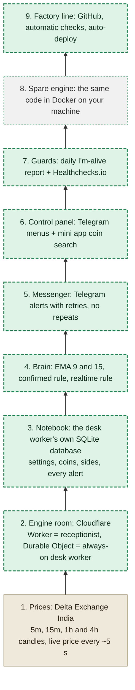
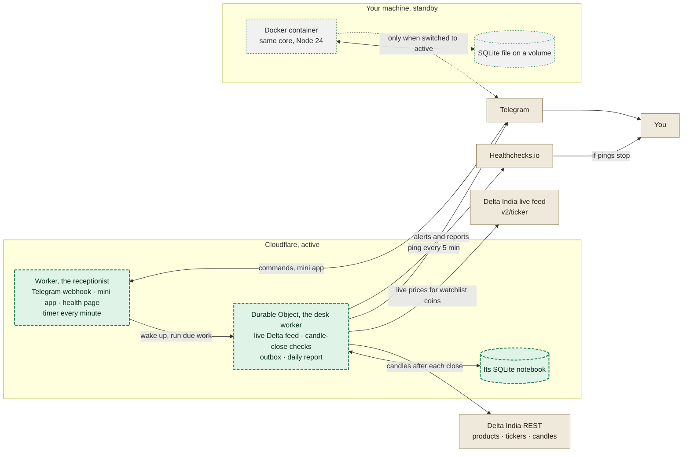
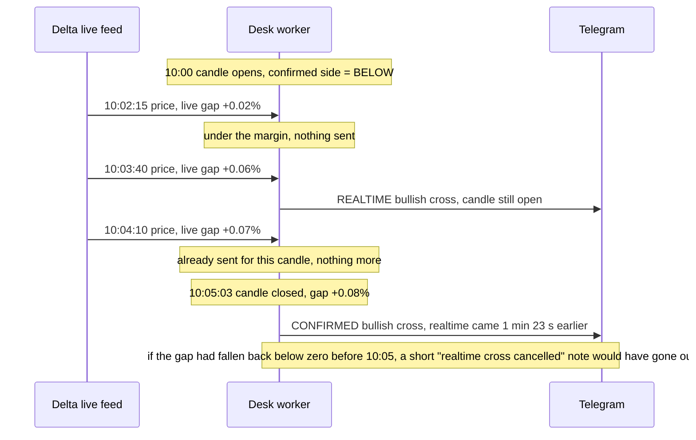

# EMA Tracker v2 build plan

Delta India on Cloudflare, Docker as the spare. Nothing in the code has changed yet; building starts when the plan is approved. Settings are listed in `SETTINGS_REFERENCE.md`.

## What you decided

| Topic | Your choice | What it means in practice |
| --- | --- | --- |
| Exchange | Delta India only | 237 perpetual coins today; Bybit code is retired. |
| Watchlist | Coins above the volume filter join automatically on 15m | Filter options $5M, $10M, $15M, $20M, $30M, $50M, $100M from Telegram; $10M to start (12 coins today). Up to 16 coins; extras are named in a note. Only watchlist coins ever alert. |
| Timeframes | Chosen per coin: 5m, 15m, 1h, 4h | New coins start on 15m only. Untick a coin's last timeframe and it leaves the watchlist: no alerts, live feed closed, and it stays out even while its volume stays above the filter. |
| Alert types | Both, on every ticked timeframe | REALTIME fires while the candle is open; CONFIRMED fires when it closes. No separate switches. |
| Margin | One margin for everything, 0.05% to start | Adjustable in Telegram: 0.00, 0.01 ... 0.10%. Same value for every coin, timeframe and alert type. |
| Realtime rule | Margin, one alert per candle, cancel note | A cross that undoes itself before the close gets a short cancel note. |
| Realtime speed | Live feed, about every 5 s | Delta's ticker feed (measured cadence about 5 s per coin). |
| Signal types | EMA 9/15 only | Price-vs-EMA 50/100/200 mode is dropped. |
| Picking coins and timeframes | Mini app with a search bar | Opens inside Telegram, lists only coins above your volume filter, with 5m / 15m / 1h / 4h ticks per coin. |
| Coin drops below filter | Pause and tell you | Realtime for it resumes by itself if volume recovers. |
| Missed alerts | LATE up to 30 min, then summary | You are never flooded after an outage. |
| Watchdog | Our own daily report first, plus Healthchecks.io | The report shows detail; Healthchecks catches the case where the bot is completely dead. |
| Where it runs | Cloudflare, with Docker as the spare | Same core code in both. One is active at a time. |
| Deploys | Automatic from GitHub after checks | A failed check blocks the deploy. |
| Chat | Your existing chat | Nothing else is running there now. |

## What we are building

Think of the bot as a ladder. Each rung rests on the one below it.

### The stack ladder, bottom rung first

Each rung only depends on the rungs below it. That is what lets the same core run on Cloudflare or in Docker.

| Rung | In plain words |
| --- | --- |
| Prices | Delta publishes finished candles and a live price. The bot reads both and never uses a half-finished candle for a confirmed alert. |
| Engine room | Cloudflare runs two pieces. The Worker is a receptionist: it answers Telegram and the coin picker, and taps the desk worker on the shoulder every minute. The Durable Object is the desk worker: one always-on helper that holds the live Delta connection, checks each candle when it closes, and keeps the notebook. |
| Notebook | A small database inside the desk worker. It remembers your settings, which coins are tracked, which side each coin was on, and every alert with its delivery status. It survives restarts. |
| Brain | Pure math with no outside contact: EMA 9 and EMA 15, the confirmed rule, and the realtime rule. Because it is pure, it can be tested on months of recorded candles. |
| Messenger | Writes each alert into the notebook first, then sends it, and retries until Telegram accepts. Every alert has an ID, so a repeat is impossible in normal running and recognisable if a crash ever causes one. |
| Control panel | Telegram buttons for margin, volume filter, timeframes, pause and reports, plus the mini app with a search bar for realtime coins. Only your Telegram account can change anything. |
| Guards | A daily report from the bot itself, an instant warning when something degrades, and Healthchecks.io for the case where the bot cannot speak at all. |
| Spare engine | The same core, wrapped for Docker on your machine. It stays quiet as standby and takes over when you switch it to active. |
| Factory line | Every change goes through GitHub, automatic checks and tests, and only then to Cloudflare. |

### Where everything runs

Cloudflare is the active engine. Docker on your machine runs the same code as a standby that sends nothing until you switch it to active. Only the active one talks to Telegram, so alerts are never doubled.

## The 5-minute check and the candle close

You asked whether the 5-minute check should line up with the candle close. It should, and the misalignment is the main bug in the current bot. Today the check runs at whatever second the bot started, so it usually lands in the middle of a candle and reads a half-finished one. In the audit replay that cost most of the alerts.

In v2, Cloudflare's timer wakes the bot at the start of every minute. When a 5-minute or 15-minute candle has just closed, the desk worker waits 3 seconds, fetches the candles, throws away the one still forming, checks that the finished one is really there, and only then runs the confirmed rule. If the finished candle is not there yet, it tries again a moment later. Your PC clock was about 10 seconds slow against Delta and Bybit, so the Docker spare uses Delta's clock instead of the PC's.

## How the watchlist works

- Your volume filter is $10M. The 12 coins above it join the watchlist automatically, each on 15m only, with realtime and confirmed alerts.
- In the mini app you search "btc" and also tick 5m and 1h. BTC now alerts on 5m, 15m and 1h.
- You untick 15m on XAUT, its only timeframe. XAUT leaves the watchlist: no more alerts, and its live Delta feed is closed. It stays out until you add it back, even while its volume stays above $10M.
- A new coin climbs above $10M. It joins on 15m and you get a short note so you can adjust or remove it.
- A watchlist coin falls below $10M for an hour. Its alerts pause and you are told. It resumes on the same timeframes if its volume recovers.
- You change the filter to $20M. Coins between $10M and $20M pause; your per-coin choices are kept for when you lower the filter again.

## How the two alert types behave

### Realtime and confirmed alerts on one candle

Example on a 5m candle for a coin you picked, margin 0.05%. Realtime uses the live price as if the candle closed now. Confirmed uses the finished candle.

|  | REALTIME | CONFIRMED |
| --- | --- | --- |
| Coins and timeframes | Watchlist coins, on each ticked timeframe (default 15m) | The same coins and timeframes |
| When | As soon as the live price pushes EMA 9 past EMA 15 by the margin, opposite to the last confirmed side | When the candle closes and the finished gap passes the margin on the other side |
| How often | At most one per coin, timeframe and candle | At most one per coin, timeframe and side change |
| Label | "REALTIME, candle still open" | "CONFIRMED, candle closed", with a line saying if a realtime alert came earlier |
| If it reverses | Short "realtime cross cancelled" note before the close; "not confirmed at close" if the close does not agree | Not applicable; it only uses finished candles |
| How it works | Takes the EMA values from the last finished candle and treats the live price as this candle's close | Recomputes EMAs from the finished candles |

## Technical choices I made, for your approval

These follow from your answers and the research. Each one can be changed before building starts.

| Choice | Why | Trade-off |
| --- | --- | --- |
| The desk worker (one Durable Object) does the heavy work, not the timer Worker | The free plan gives the timer Worker 10 ms of CPU per run; my estimate for 32 candle series was right at that edge. A Durable Object gets 30 s per event. | One desk worker means one place for everything; if Cloudflare restarts it, it reloads from its notebook and reconnects. |
| Its built-in SQLite as the notebook, not D1 or KV | Transactions in one place, no per-query limit (D1 queries count against the 50-call limit per run), and the same SQL runs in Docker through node:sqlite. | Data lives with the desk worker; exports go through a /backup command. |
| Telegram webhook on Cloudflare, long polling in Docker | A Worker cannot sit and wait for messages; Telegram pushes to it instead. Docker behind your router cannot receive pushes, so it asks. | Telegram allows only one of the two at a time, so switching engines also switches this (handled by the switch command). |
| Manual switch between Cloudflare and Docker, automatic later | Automatic takeover between two separate notebooks can double alerts. A one-step manual switch is safe now. | You make the call during an outage. Automatic failover is a later slice once the basics run. |
| TypeScript, no third-party runtime packages | Removes the 19 npm audit findings and the deprecated packages in your build log. Cloudflare and Node 24 both run it. | About 200 lines of our own Telegram and HTTP code. |
| Store each coin's confirmed side and fetch 150 candles | On the audit data, 150 candles plus a remembered side give exactly the full-history answer. If the side is ever lost, 1,000 candles rebuild it once. | One more table in the notebook. |
| Split candle checks into batches of up to 40 requests per desk-worker run | At a 4-hour boundary, 16 coins on all four timeframes would need 64 candle requests; the free plan allows 50 outside calls per run. The desk worker processes 40, then immediately starts a follow-up run for the rest. | The last batch arrives a second or two later. |
| Pin Wrangler as a dev dependency and run checks in the build command | Your build downloaded the latest Wrangler each time and deployed with no checks. | None. |

## Every bug and where it gets fixed

I1 to I14 are from the audit. B1 to B8 are from your Cloudflare build log and the deployment review.

| ID | Bug | How v2 fixes it | Slice |
| --- | --- | --- | --- |
| B1 | No wrangler.jsonc, so Wrangler looked for a static website and failed | Add wrangler.jsonc with the Worker entry, timer, Durable Object and its migration | S0 |
| B2 | main.js needs Node-only parts (files, child_process, raw sockets, an HTTP server, a process that never stops) | New Worker-native code; main.js retired | S4, S8 |
| B3 | Wrangler not pinned; every build downloads the newest version | Pinned dev dependency | S0 |
| B4 | Deprecated packages installed on every build (request, uuid 3, har-validator) | No third-party runtime packages | S1 |
| B5 | Builds deploy with no type check or tests | Build command runs type check and tests; a failure stops the deploy | S0 |
| B6 | Your PC clock is about 10 s slow | Cloudflare's clock in the cloud; Delta's clock in Docker | S2 |
| B7 | Delta limits by IP and Cloudflare IPs are shared; Delta rejects requests without a User-Agent | User-Agent on every call; obey Delta's reset header on 429; measured in the S0 probe | S0, S2 |
| B8 | Telegram allows a webhook or polling, not both | The engine switch sets the right one | S7 |
| I1 | Half-finished candles and two writers corrupt the cache | Closed candles only, one writer (the desk worker) | S2, S4 |
| I2 | The 0.03% margin threw away 79% of crosses | Confirmed rule plus realtime alerts | S1 |
| I3 | Alerts lost silently on Telegram failure | Outbox: record first, send, retry, report | S3 |
| I4 | Bot token in public git history | You confirm it is revoked; secret scanning in the build; secrets only in Cloudflare's store | S0 |
| I5 | A failed stats call crashed the alert text | Numbers taken from Delta's ticker, typed, never blocking the alert | S3 |
| I6 | Old Docker image: Node 18, root user, no .dockerignore, fake health check | New image: Node 24, non-root, .dockerignore, real health check | S7 |
| I7 | State kept in files that do not survive | Notebook in the desk worker; Docker uses a volume | S3, S7 |
| I8 | WebSocket drops went unnoticed | Feed silence over 30 s triggers a reconnect; confirmed alerts do not depend on the live feed | S4 |
| I9 | Slow, serialized extra calls before every alert | Alert first, details from the cached ticker | S3, S4 |
| I10 | 19 vulnerable dependencies | No third-party runtime packages | S1 |
| I11 | Single-EMA mode started from too little history | Mode removed (EMA 9/15 only) | S1 |
| I12 | fly.toml, render.yaml and the README claim free hosting that does not exist | Files removed, README rewritten | S8 |
| I13 | Log spam, health page always "ok", two bots on one token | Daily report, instant degraded warnings, Healthchecks.io, one active engine | S6, S7 |
| I14 | One 3,152-line file with no tests | Small modules with tests and recorded-data replays | S1 onward |

## Build plan

### Build order

Each slice ends in something you can see working. S0 tests the riskiest assumption first, before most of the code exists.

```mermaid
flowchart LR
  S0["S0 Fix deploy +<br/>24 h Cloudflare probe"]:::proposed --> S1["S1 Core brain<br/>+ tests"]:::proposed --> S2["S2 Delta<br/>connector"]:::proposed --> S3["S3 Notebook +<br/>messenger"]:::proposed --> S4["S4 Cloudflare<br/>engine live"]:::proposed --> S5["S5 Telegram menus<br/>+ mini app"]:::proposed --> S6["S6 Guards +<br/>catch-up"]:::proposed --> S7["S7 Docker<br/>spare"]:::proposed --> S8["S8 Retire<br/>main.js"]:::proposed
  classDef proposed fill:#dff3e6,stroke:#1e7f4f,stroke-width:2px,stroke-dasharray:6 3,color:#0d2e1c;
```

| Slice | What gets built | Done when | Needs from you |
| --- | --- | --- | --- |
| S0 | wrangler.jsonc, pinned Wrangler, checks in the build, secret scanning, and a small probe that runs on Cloudflare for 24 h: Delta REST and live feed from Cloudflare's network, desk-worker uptime, reconnects, message counts and free-plan usage | The deploy is green and the probe report shows Delta reachable and usage inside the free plan. If not, I come back to you with options before building further | Confirm the old bot token is revoked; add secrets in the Cloudflare dashboard (I will list the clicks); approve pushing a branch |
| S1 | Core brain: settings schema, EMA, confirmed rule, realtime rule, alert IDs; tests; Delta history recorded as fixtures | All tests pass; replay numbers for 0.00 to 0.10% recorded | Nothing |
| S2 | Delta connector: products, tickers, candles with the closed-candle filter, live feed parsing, 429 handling | Tests on recorded Delta replies pass | Nothing |
| S3 | Notebook schema and the messenger (outbox, retries, digest, LATE handling) | Crash-and-restart tests show no lost and no repeated alerts | Nothing |
| S4 | Cloudflare engine: Worker routes, minute timer, desk worker with candle-close checks on 5m/15m/1h/4h, batched requests, and a live feed that subscribes and unsubscribes as the watchlist changes | Confirmed and realtime alerts arrive in your chat | Watch the chat for a day |
| S5 | Telegram menus (margin, volume filter, default timeframes, pause, report time) and the mini app: search, per-coin 5m/15m/1h/4h ticks, remove and re-add coins | You can change every setting, tick timeframes per coin and remove coins from Telegram; removing a coin closes its live feed | Try it |
| S6 | Guards: daily report, instant degraded warnings, Healthchecks pings, catch-up after outages | Stopping the bot produces a Healthchecks alert within 15 min; restarting sends LATE alerts or a summary | Set the check to period 5 min, grace 10 min |
| S7 | Docker spare: Node shell, Dockerfile, compose file, engine switch command and a one-page runbook | Switching to Docker and back works with no doubled alerts | Docker running on your machine |
| S8 | Retire main.js, old platform files and the old README; final review | Repo contains only v2; three calm days of alerts | Approve the removal |

Rough effort: S0 half a day plus the 24 h wait; S1 to S6 about 6 to 9 working days; S7 and S8 about 2 days. Each slice is reviewed with you before the next one starts.

## Open risks and what I could not verify

- Whether a Durable Object can hold Delta's live feed around the clock on the free plan. Cloudflare says an open outgoing connection keeps it in memory for at least 15 minutes and may keep it longer; it does not say how those messages are counted. S0 measures this before anything depends on it.
- Whether Delta accepts requests from Cloudflare's shared IP addresses as reliably as from your PC. S0 measures this too.
- Realtime on every watchlist coin means about 200,000 live messages a day at 12 coins (measured cadence: one per coin every ~5 s). If Cloudflare counts each one against the free plan's 100,000 daily requests, realtime will not fit for all coins. S0 tests with 12 coins; if it does not fit I will bring you the options (fewer realtime coins, minute checks for some, the Docker spare for realtime, or the $5 plan).
- Delta's WebSocket documentation section could not be read; the feed address, subscribe format and the about-5-second cadence come from a live 20-second test, not from the docs.
- The daily report time assumes India time (Delta India users are in India). You can change it in Telegram.
- Two of today's top coins by volume, XAUT and PAXG, are gold tokens, not crypto. They join the watchlist like any coin; remove them in the mini app if you do not want them.
- Signal quality and trading results are not evaluated or claimed.
